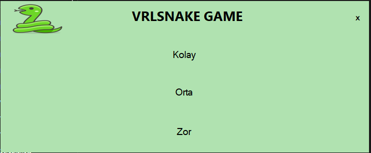
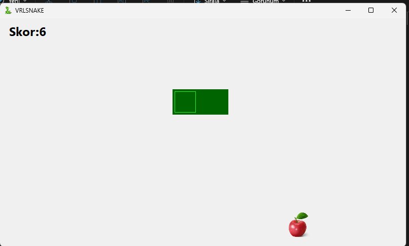
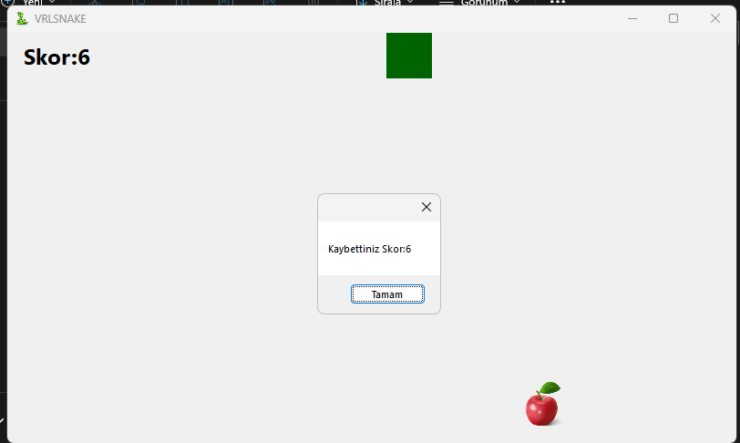

# Snake Game

C# ve Windows Forms kullanarak üniversitede geliştirdiğim basit bir yılan oyunu.

Oyunda amaç, yılanı kontrol ederek yemleri toplamak ve mümkün olduğunca yüksek skor elde etmek.

## Özellikler

- Kolay, orta ve zor olmak üzere 3 farklı zorluk seviyesi
- W, A, S, D tuşlarıyla yılanı kontrol etme
- Yemlerin oyun alanında rastgele konumlarda oluşması
- Her yem toplandığında yılanın büyümesi ve skorun artması
- Yılanın oyun alanının sınırlarından geçtiğinde karşı taraftan devam etmesi
- Yılanın kendi gövdesine çarptığında oyunun sona ermesi
- Oyun bitiminde skorun gösterilmesi ve ana menüye dönüş

## Kullanılan Teknolojiler

- C#
- Windows Forms
- .NET Framework 4.7.2
- Visual Studio

## Kontroller

| Tuş | Hareket |
|---|---|
| W | Yukarı |
| A | Sol |
| S | Aşağı |
| D | Sağ |

## Ekran Görüntüleri

### Ana Menü

### Oyun Ekranı

### Oyun Bitişi

## Çalıştırma

Projeyi indirip `snakegame.sln` dosyasını Visual Studio ile açarak çalıştırabilirsiniz.

Bu proje, üniversitede C# ve Windows Forms üzerinde pratik yapmak amacıyla geliştirdiğim çalışmalardan biridir.